# isAnMoney

**English** · [Русский](README.ru.md)

Personal finance tracker for Android — a modern remake of the abandoned **anMoney**.
Offline, no ads, no analytics, no accounts. Your data never leaves your phone.

> **Status: free test build.** This is an early version shared for testing.
> There is no trial and no purchase in this build.

## Features

- Accounts of nine types (bank, cash, credit card, credit line, investment, other liability, real estate, vehicle, other asset), each in its own currency
- Income, expenses and transfers (including transfers between currencies), split transactions, two optional classifications (people / projects)
- Two-level categories, payees with autocomplete, search across transactions
- **Budgets**: limits by category, person, project and payee; limits change by date and the old ones are kept (archive); planned income; **an event (project) budget by category**
- **Scheduled transactions**: recurring items entered with the same form as ordinary transactions
- Reports: spending structure, income/expense over time, balance over time, table over time, **“Plan vs actual”** (running actual against the plan, income and expense together); rows can be ordered by name (“A→Z”)
- **Your own reports**: a builder grouped by a list; export of reports to Excel and CSV
- Multi-currency with manual exchange rates and rate history
- **Moves your anMoney history over** via QIF import, with a reconciliation screen so balances match (split parts that were a transfer to another account become separate transfers)
- Import and export: CSV, QIF; password-protected `.isanmoney` backups (manual or scheduled)
- A transaction form with buttons at the bottom, within thumb reach; Quick Entry home-screen widget, optional PIN lock, English and Russian interface

## Screenshots

<table>
<tr><td align="center">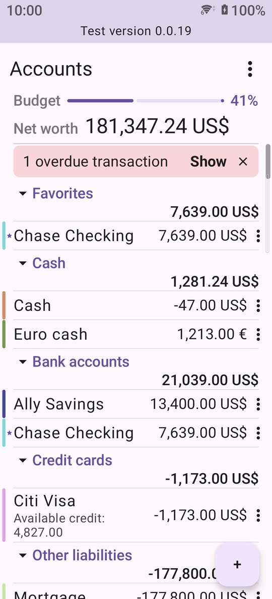<br>Accounts</td><td align="center">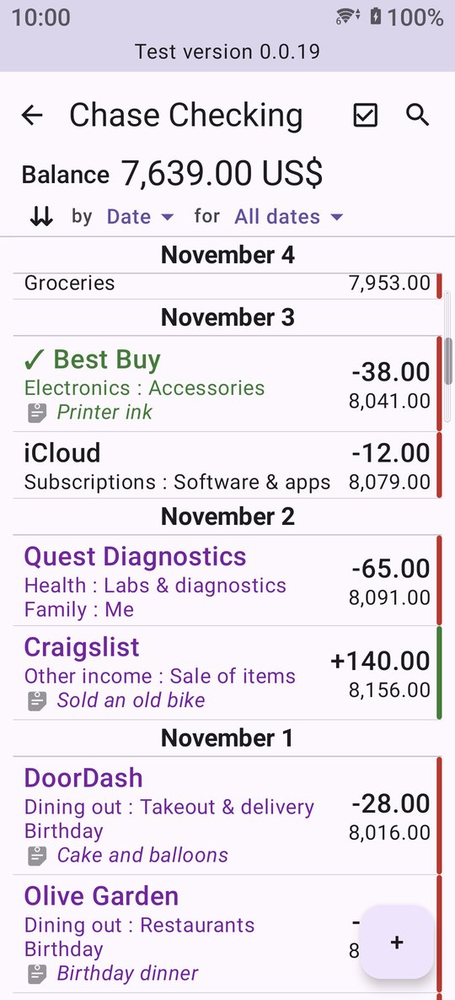<br>Account register</td><td align="center">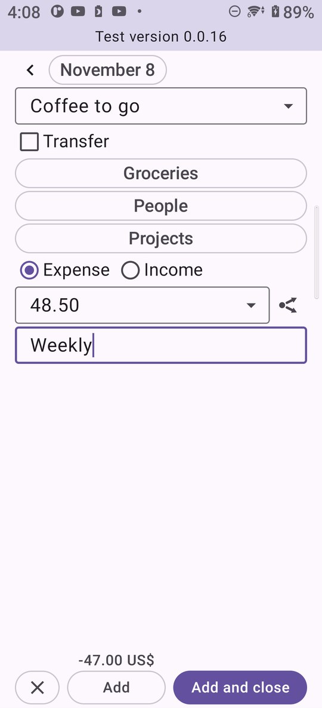<br>New transaction</td></tr>
<tr><td align="center">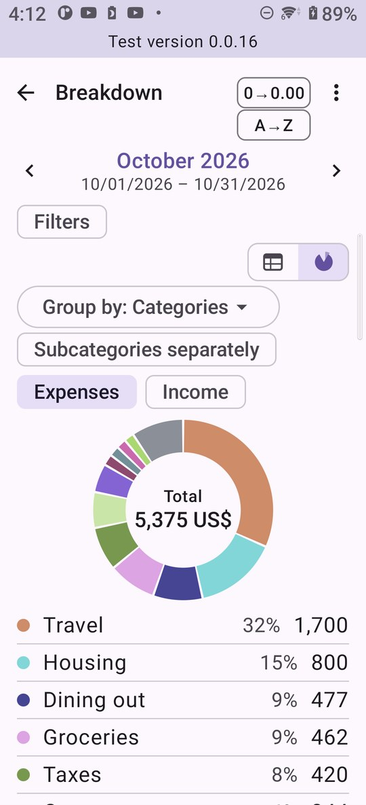<br>Spending by category</td><td align="center">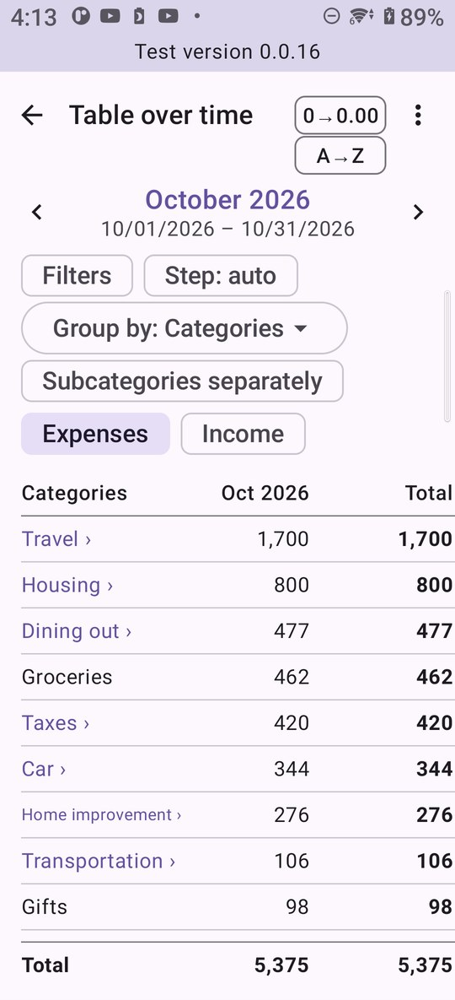<br>Categories by month</td><td align="center">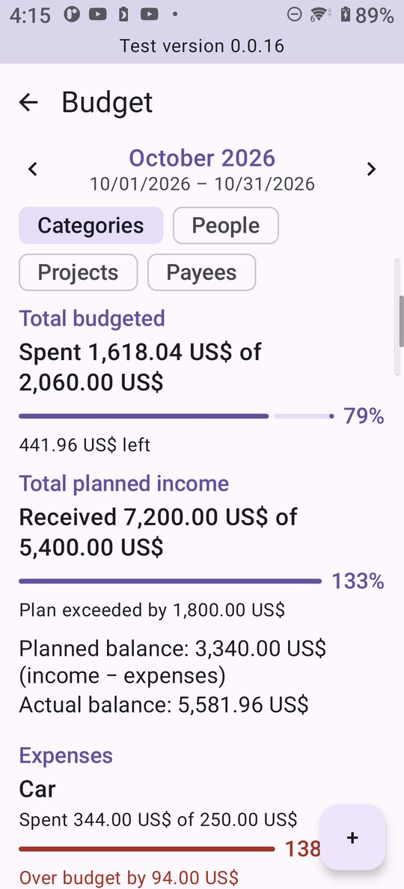<br>Budget</td></tr>
<tr><td align="center">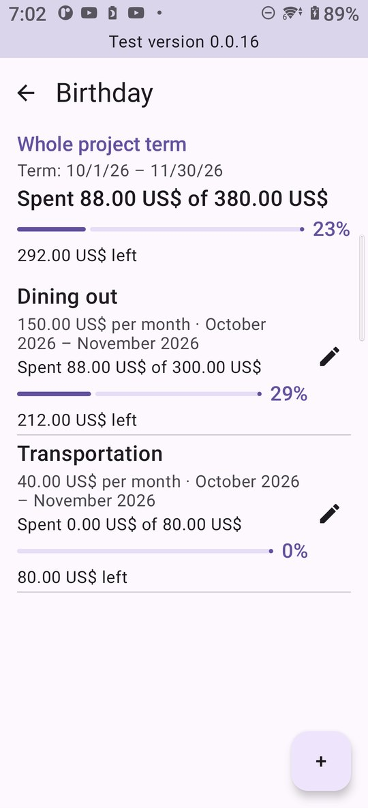<br>Project budget by category</td><td align="center">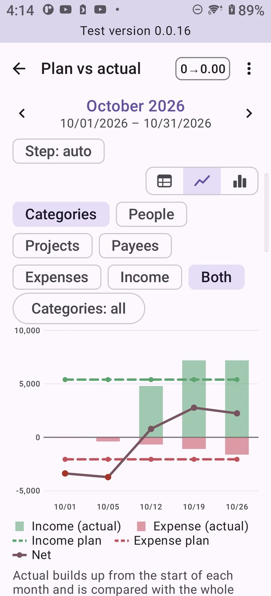<br>Plan vs actual</td><td align="center">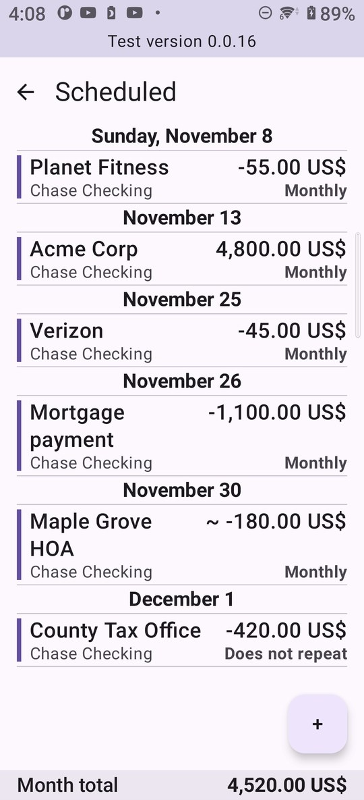<br>Scheduled transactions</td></tr>
<tr><td align="center">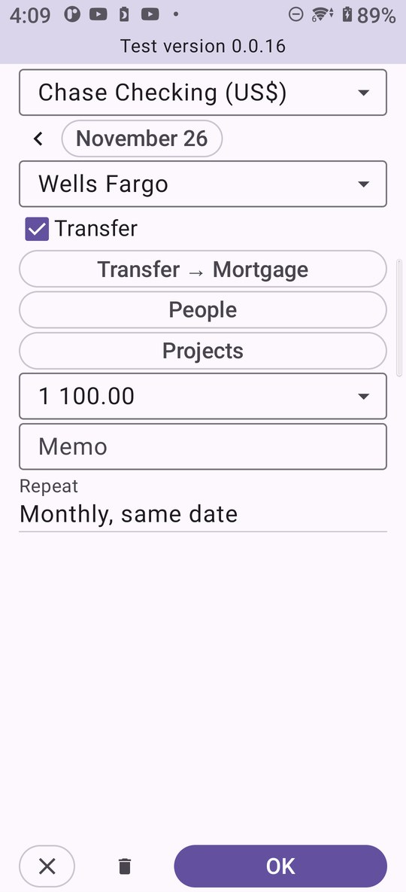<br>Scheduled transaction</td><td align="center">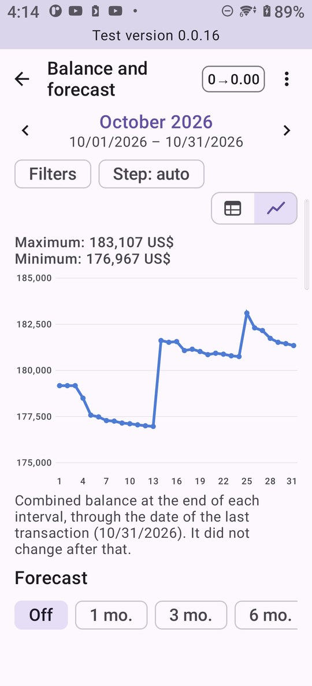<br>Balance</td><td align="center">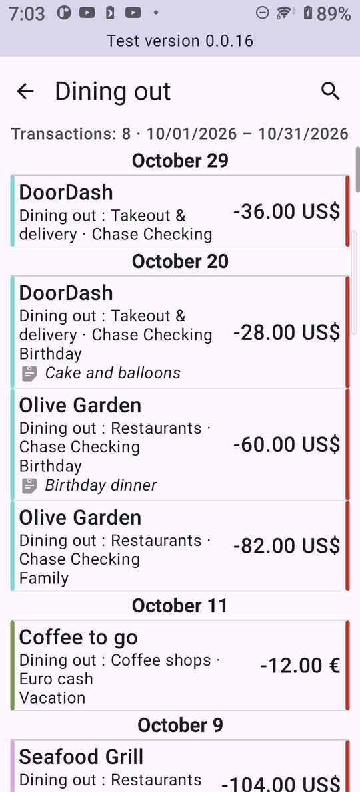<br>Transactions behind a report row</td></tr>
<tr><td align="center">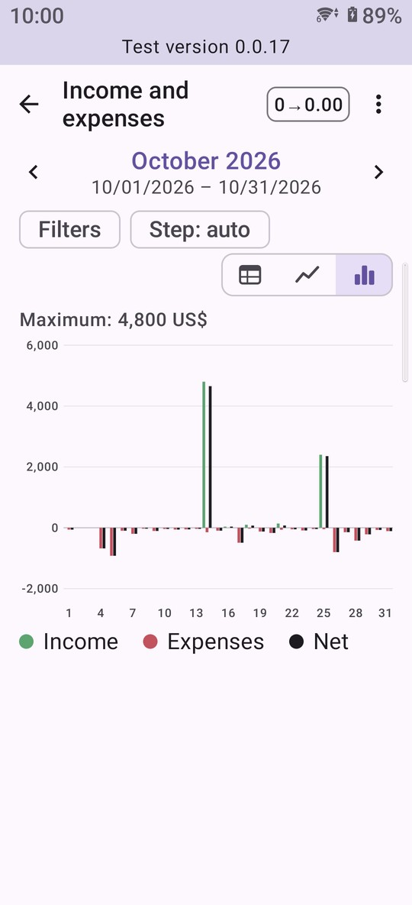<br>Income and expenses over time</td><td align="center">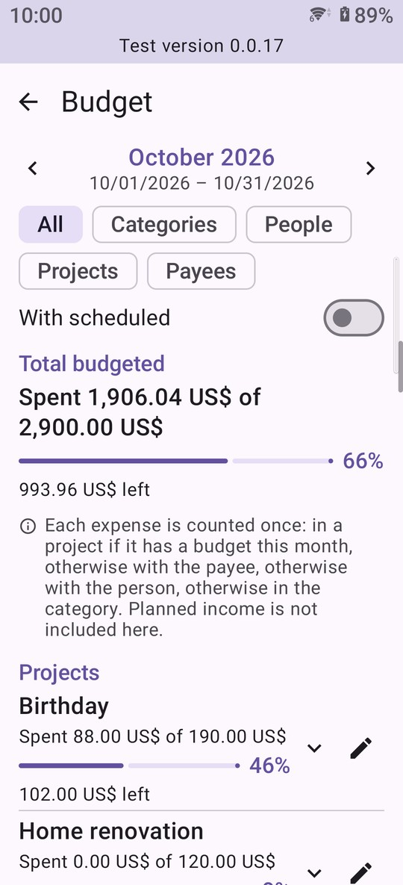<br>Budget: all at once</td><td align="center">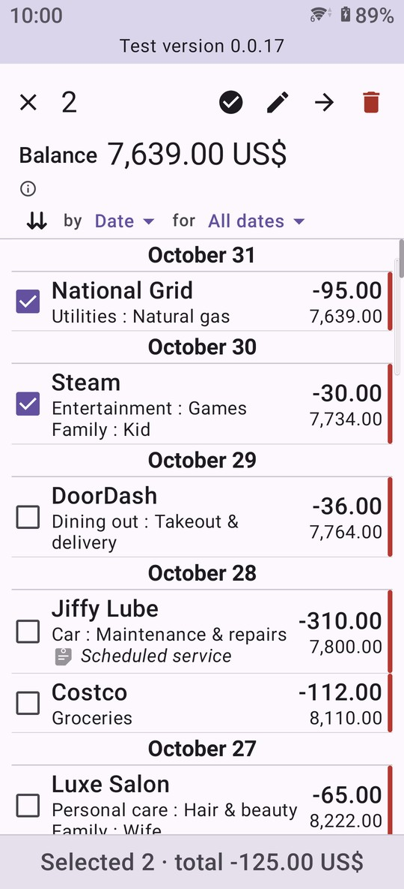<br>Select several transactions</td></tr>
</table>

## Install

1. Download the latest `.apk` from the [Releases](../../releases) page on your phone.
2. Open it. If Android asks, allow installing apps from your browser or file manager.
3. Play Protect may warn that the app is from an unknown developer — the app is not distributed through Google Play yet. Choose **Install anyway**.

Requires **Android 8.0** or newer. Updates are manual: install a newer APK over the old one, your data is kept.

### Verify the download (optional)

Each release has a `.sha256` file next to the APK:

```
sha256sum -c isAnMoney-*.apk.sha256        # Linux / macOS
Get-FileHash isAnMoney-*.apk -Algorithm SHA256   # Windows PowerShell
```

The APK is signed with a certificate whose SHA-256 fingerprint is:

```
ED:64:EC:15:CE:38:44:A2:A2:22:63:19:2B:3D:32:D2:53:1D:00:33:C4:76:A2:12:4C:A0:BA:85:B2:37:06:4F
```

(`apksigner verify --print-certs <file>.apk` shows it.)

## Moving from anMoney

1. In anMoney, export all accounts to QIF. Choose the status **All transactions** — otherwise "Unexported" ones are skipped.
2. Copy the files to your phone.
3. In isAnMoney: menu → **Import/Export → Moving from anMoney**, then follow the steps (check each account's currency and type, then reconcile balances and set today's exchange rates).

Import into an empty book: importing the same files twice duplicates transactions.

## Privacy

- All data is stored only on your device, in an encrypted database. The key lives in the Android Keystore.
- The app has **no internet access**, no ads, no analytics.
- If the app crashes it offers to send a crash report — only with your consent, you see the text first and choose where to send it. It contains the app version, phone model and a technical error trace, never your accounts, amounts or payees.
- Backups (`.isanmoney`) are protected by your own password. **A forgotten password cannot be recovered.**
- The PIN is a screen lock, not encryption of your data.

Full text: [PRIVACY_POLICY.md](PRIVACY_POLICY.md) (English), [PRIVACY_POLICY.ru.md](PRIVACY_POLICY.ru.md) (Russian).

## Feedback and bug reports

Please tell me what breaks or feels wrong: **Settings → Report a problem** in the app, or write to **itartel2075@gmail.com**.
When reporting, mention your phone model, Android version and the app version (shown under the app name in Android settings).
