# isAnMoney

[English](README.md) · **Русский**

Приложение для учёта личных финансов на Android — современный ремейк заброшенного **anMoney**.
Работает офлайн, без рекламы, без аналитики и без регистрации. Ваши данные не покидают телефон.

> **Статус: бесплатная тестовая сборка.** Ранняя версия для проверки.
> В этой сборке нет ни пробного периода, ни покупки.

## Возможности

- Счета девяти типов (банковский, наличные, кредитная карта, кредитная линия, инвестиционный, другое обязательство, недвижимость, транспорт, другой актив), у каждого своя валюта
- Доходы, расходы и переводы (в том числе между валютами), разбиение операции на части, две необязательные классификации (участники / проекты)
- Категории в два уровня, получатели с автодополнением, поиск по операциям
- **Бюджет**: лимиты по категориям, участникам, проектам и получателям; лимиты меняются по датам, старые не пропадают (архив); плановые доходы; **бюджет события (проекта) по категориям**
- **Запланированные операции**: повторы по расписанию, вводятся той же формой, что и обычные операции
- Отчёты: структура расходов, доходы и расходы по времени, баланс по времени, таблица по времени, **«План и факт»** (нарастающий факт против плана, доходы и расходы вместе), строки можно упорядочить по названию («А→Я»)
- **Свои отчёты**: конструктор с разрезом по справочнику; выгрузка отчётов в Excel и CSV
- Мультивалютность: курсы вводятся вручную, есть история курсов
- **Перенос истории из anMoney** через импорт QIF и экран сверки, чтобы остатки совпали (части split, бывшие переводом на другой счёт, становятся отдельными переводами)
- Импорт и экспорт: CSV, QIF; резервные копии `.isanmoney` под вашим паролем (вручную или по расписанию)
- Форма операции с кнопками внизу, под большим пальцем; виджет быстрого ввода, необязательный PIN-код, интерфейс на английском и русском

## Скриншоты

<table>
<tr><td align="center">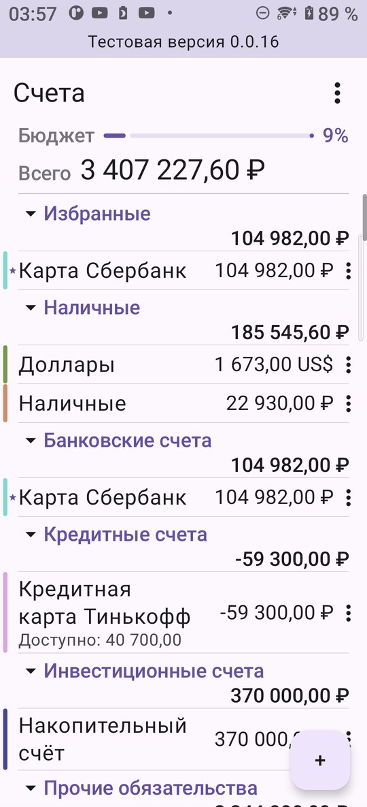<br>Счета</td><td align="center">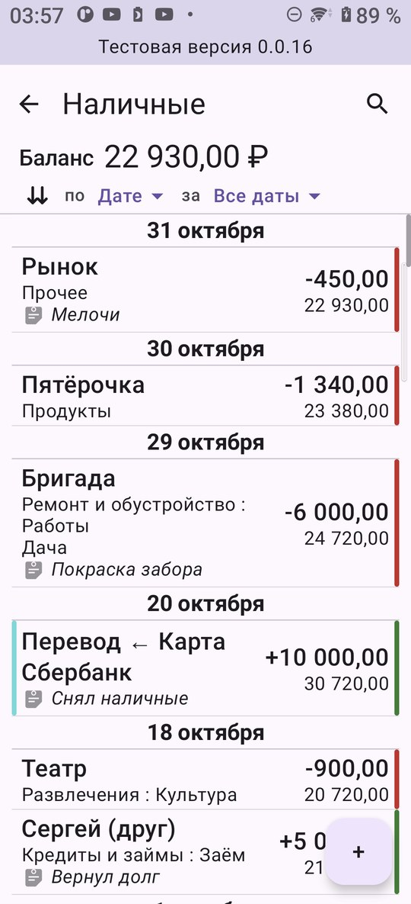<br>Журнал счёта</td><td align="center">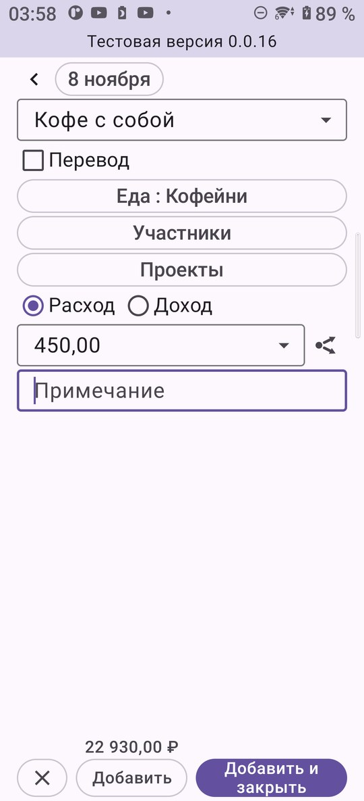<br>Новая операция</td></tr>
<tr><td align="center">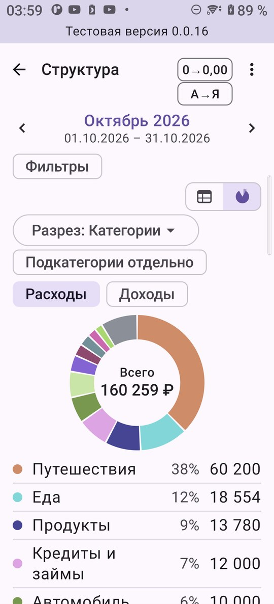<br>Расходы по категориям</td><td align="center">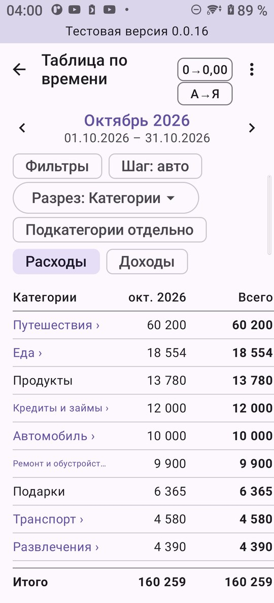<br>Категории по месяцам</td><td align="center">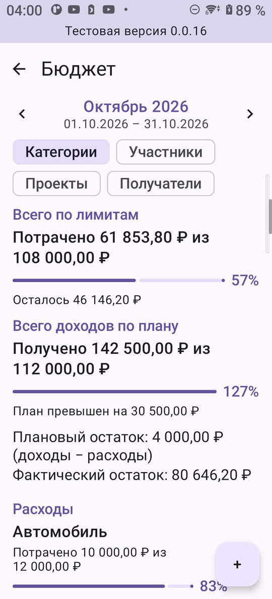<br>Бюджет</td></tr>
<tr><td align="center">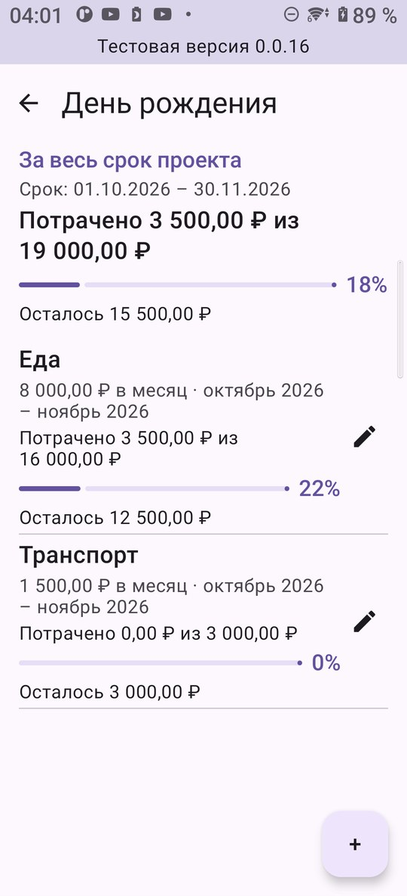<br>Бюджет проекта по категориям</td><td align="center">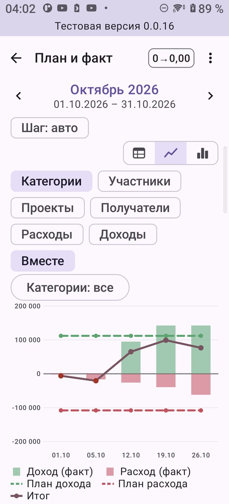<br>План и факт</td><td align="center">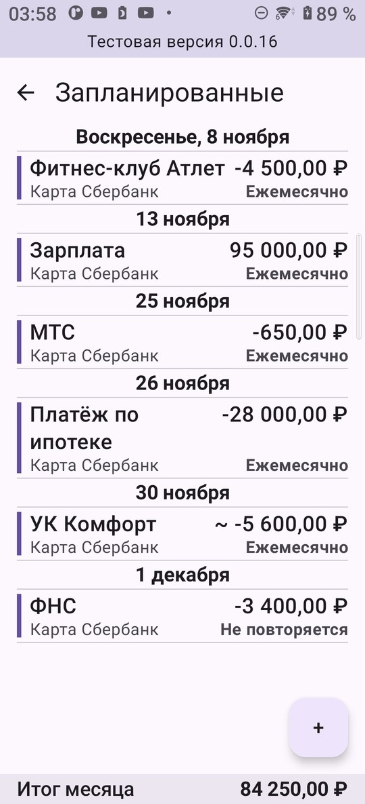<br>Запланированные</td></tr>
<tr><td align="center">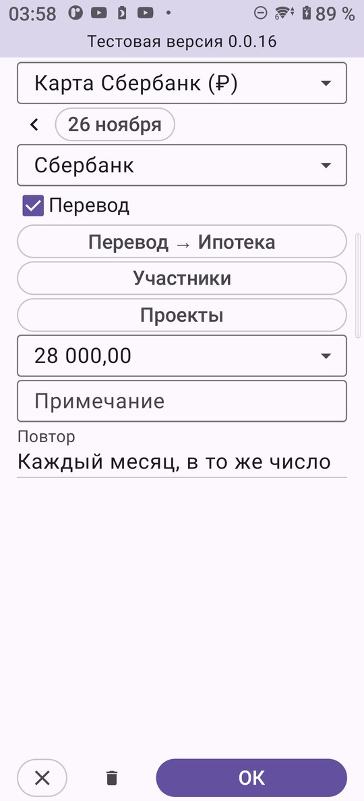<br>Запланированная операция</td><td align="center">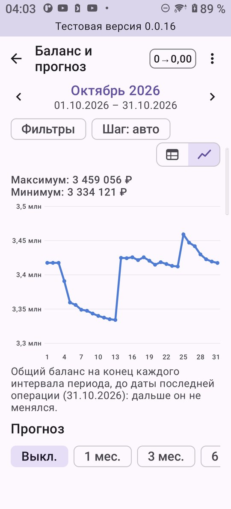<br>Баланс</td><td align="center">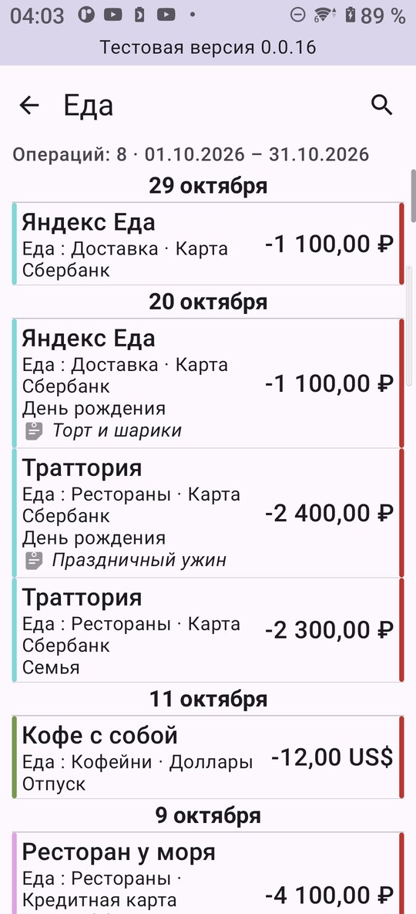<br>Операции строки отчёта</td></tr>
</table>

## Установка

1. Скачайте последний `.apk` на странице [Releases](../../releases) прямо на телефоне.
2. Откройте файл. Если Android попросит, разрешите установку приложений из браузера или файлового менеджера.
3. Play Protect может предупредить о неизвестном разработчике: приложения пока нет в Google Play. Выберите **Всё равно установить**.

Нужен **Android 8.0** или новее. Обновления ставятся вручную: установите новый APK поверх старого, данные сохранятся.

### Проверка загруженного файла (по желанию)

Рядом с APK в каждом релизе лежит файл `.sha256`:

```
sha256sum -c isAnMoney-*.apk.sha256        # Linux / macOS
Get-FileHash isAnMoney-*.apk -Algorithm SHA256   # Windows PowerShell
```

APK подписан сертификатом с отпечатком SHA-256:

```
ED:64:EC:15:CE:38:44:A2:A2:22:63:19:2B:3D:32:D2:53:1D:00:33:C4:76:A2:12:4C:A0:BA:85:B2:37:06:4F
```

(`apksigner verify --print-certs <файл>.apk` показывает его.)

## Перенос из anMoney

1. В anMoney выгрузите все счета в QIF со статусом **«Все транзакции»**, иначе «Невыгруженные» в файл не попадут.
2. Перенесите файлы на телефон.
3. В isAnMoney: меню → **Импорт/Экспорт → Перенос из anMoney**, дальше по шагам: проверьте валюту и тип каждого счёта, затем сверьте остатки и введите курсы валют на сегодня.

Импортируйте в чистую книгу: повторный импорт тех же файлов задвоит операции.

## Конфиденциальность

- Все данные хранятся только на вашем устройстве, в зашифрованной базе. Ключ лежит в Android Keystore.
- У приложения **нет доступа в интернет**, нет рекламы и аналитики.
- Если приложение неожиданно закроется, оно предложит отправить отчёт о сбое, только с вашего согласия: вы видите текст до отправки и сами выбираете, куда его отправить. В нём версия приложения, модель телефона и техническая запись ошибки, без ваших счетов, сумм и получателей.
- Резервные копии (`.isanmoney`) защищены вашим паролем. **Забытый пароль восстановить нельзя.**
- PIN-код — замок на экране приложения, а не шифрование данных.

Полный текст: [PRIVACY_POLICY.ru.md](PRIVACY_POLICY.ru.md) (русский), [PRIVACY_POLICY.md](PRIVACY_POLICY.md) (английский).

## Обратная связь и отчёты о проблемах

Напишите, что ломается или неудобно: **Настройки → Сообщить о проблеме** в приложении или на **itartel2075@gmail.com**.
В сообщении укажите модель телефона, версию Android и версию приложения (она видна под названием приложения в настройках Android).
